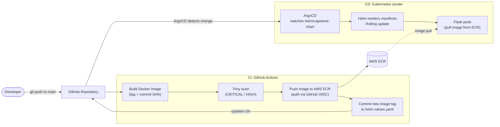
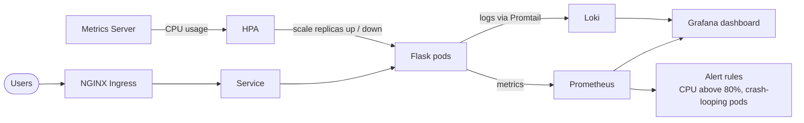
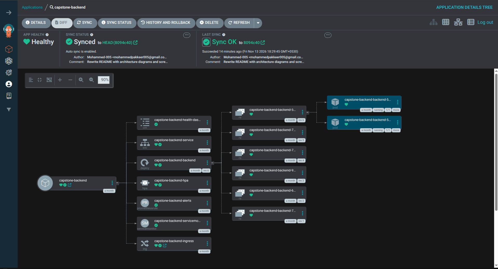

# DevOps Capstone: GitOps CI/CD on Kubernetes

An end-to-end, fully automated deployment pipeline for a containerized Flask app. A `git push` builds the image, scans it, pushes it to AWS ECR, and updates the Helm chart. ArgoCD then syncs the Kubernetes cluster to match Git, with autoscaling and monitoring built in.

**Highlights**

- **Zero manual deploy steps:** CI commits the new image tag back to the Helm chart and ArgoCD rolls it out.
- **Secure by default:** keyless AWS auth from CI (GitHub OIDC), Trivy image scanning, and the ECR pull secret encrypted with Sealed Secrets so it is safe to store in Git.
- **Self-scaling:** CPU-based Horizontal Pod Autoscaler (HPA) with Metrics Server.
- **Observable:** Prometheus alerts, a Grafana dashboard stored as code, and Loki/Promtail for centralized pod logs.

---

## Architecture

### Pipeline flow



### Runtime: scaling and observability



---

## How it works

### 1. Continuous Integration (GitHub Actions)
Triggers on every push to `main`:
1. Builds the Docker image and tags it with the Git commit SHA.
2. Scans the image with **Trivy** for CRITICAL/HIGH vulnerabilities.
3. Authenticates to AWS with **GitHub OIDC** (short-lived credentials, no static keys stored in GitHub) and pushes the image to a private **AWS ECR** registry.
4. Commits the new image tag back to the Helm chart's `values.yaml`.

### 2. Continuous Deployment (ArgoCD and Kubernetes)
- ArgoCD runs in the cluster and watches `helm/capstone-chart/` (pull-based GitOps).
- When the chart or `values.yaml` changes, ArgoCD renders the Helm chart and syncs the cluster to match Git.
- Kubernetes pulls the image from ECR using an image pull secret, stored in Git as a **Sealed Secret**.
- Updates roll out as rolling deployments, so the app stays available during releases.

### 3. Autoscaling
- **Metrics Server** provides pod resource metrics.
- A **Horizontal Pod Autoscaler** scales replicas up under load and back down to save resources, based on CPU against the pod's requests and limits.

### 4. Observability
- **Prometheus** scrapes metrics and fires alert rules: pod CPU above 80% of its limit, and crash-looping pods.
- **Grafana** dashboard is stored as code in Git (ConfigMap) so it is reproducible.
- **Loki + Promtail** collect pod logs centrally, viewable in Grafana Explore.

---

## Tech stack

| Area | Tools |
|---|---|
| Application | Python, Flask, Gunicorn |
| Containerization | Docker (multi-stage build, slim base image) |
| Orchestration | Kubernetes (kind), NGINX Ingress |
| Packaging | Helm |
| CI/CD / GitOps | GitHub Actions, ArgoCD |
| Security | Trivy, GitHub OIDC, Sealed Secrets |
| Cloud | AWS ECR, IAM |
| Monitoring | Prometheus, Grafana, Loki, Promtail |

---

## Repository structure

```
├── .github/workflows/ci.yaml   # CI pipeline: build, scan, push, tag update
├── helm/capstone-chart/        # Helm chart for the application
│   ├── Chart.yaml              # Chart metadata and versioning
│   ├── values.yaml             # Config (replicas, image tag, HPA targets)
│   └── templates/              # Deployment, Service, HPA, Ingress, alert rules
├── Dockerfile                  # Multi-stage image build
├── argocd-app.yaml             # ArgoCD Application pointing at the Helm path
├── app.py                      # Flask microservice
└── requirements.txt            # App dependencies
```

---

## Screenshots

> Add your own screenshots here (see the `docs/` folder).

| ArgoCD (Synced / Healthy) | Grafana dashboard |
|---|---|
|  |  |

---

## Run it yourself

```bash
# 1. Create a local cluster
kind create cluster

# 2. Install ArgoCD
kubectl create namespace argocd
kubectl apply -n argocd -f https://raw.githubusercontent.com/argoproj/argo-cd/stable/manifests/install.yaml

# 3. Deploy the app through GitOps
kubectl apply -f argocd-app.yaml
```

Requires an AWS ECR repository and the GitHub OIDC role configured for the CI pipeline.
